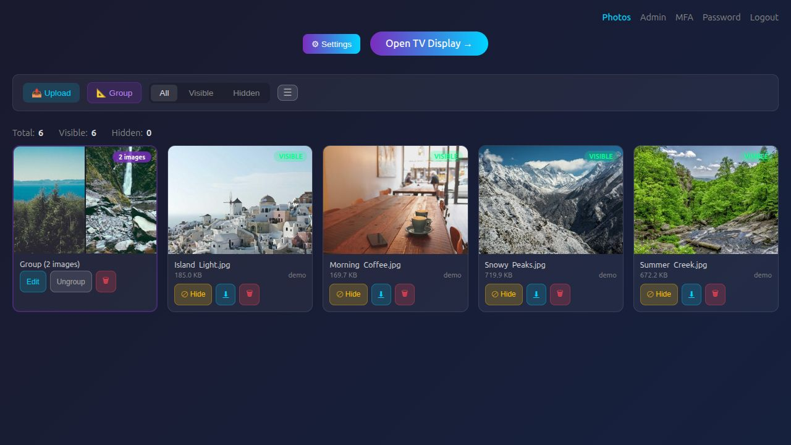

# OpenFotoFrame

A self-hosted photo frame for Raspberry Pi and Linux, managed from a browser or iPhone/iPad.




## Features

- Upload and manage photos from your browser or the [iOS app](ios/README.md).
- Crop, scale, reorder and group photos.
- Customize mat colors, textures and borders.
- Play photo slideshows or animated artwork on multiple displays.
- Run fullscreen in a browser or Chromium kiosk.
- Manage user accounts with optional multi-factor authentication.
- Schedule TV power with HDMI-CEC.
- Back up photos and settings to Dropbox.

## General-release work

An opt-in release server and native onboarding support both a paid hosted service
and independently hosted servers. They are separate from the legacy installation
below and are not enabled by updating this checkout. See [release readiness](docs/RELEASE_READINESS.md),
[architecture and access control](docs/RELEASE_ARCHITECTURE.md),
[migration rehearsal](docs/RELEASE_MIGRATION.md), and [hosted operations](docs/HOSTED_OPERATIONS.md).
Paid launch and production migration remain gated; the release backend does not
yet execute physical TV power schedules or install a durable export worker.

## Install

Use a Linux machine; a desktop environment is needed only for a local Chromium kiosk.

```sh
git clone https://github.com/abwagner/openfotoframe.git
cd openfotoframe
./scripts/install.sh
```

1. Choose backend + display, backend only, or display only.
2. Open `https://<your-host>/upload` and sign in as `admin` with the one-time password printed by the installer.
3. Set your password, upload photos, and open `/display` on the frame.

See [installation and networking](docs/INSTALLATION.md) for HTTPS, remote access and kiosk setup.
For a disposable preview, use the [local stock-photo demo](docs/LOCAL_DEMO.md).

## Critical notes

- Change the initial password on first login; passwords must be at least 12 characters.
- Enroll remote displays at `/display/enroll`. Never put enrollment secrets in URLs.
- Keep the persistent data and upload volumes when updating. Back up private credentials separately.
- Use trusted HTTPS for public access. Enable proxy trust only behind a trusted reverse proxy.

[User guide](docs/USER_GUIDE.md) · [Backups, updates and recovery](docs/OPERATIONS.md) ·
[Security](SECURITY.md) · [Security configuration](docs/SECURITY_CONFIGURATION.md) ·
[API](docs/API.md) · [Development](docs/DEVELOPMENT.md)

[Photo credits](docs/LOCAL_DEMO.md#photo-credits) · [MIT license](LICENSE)
