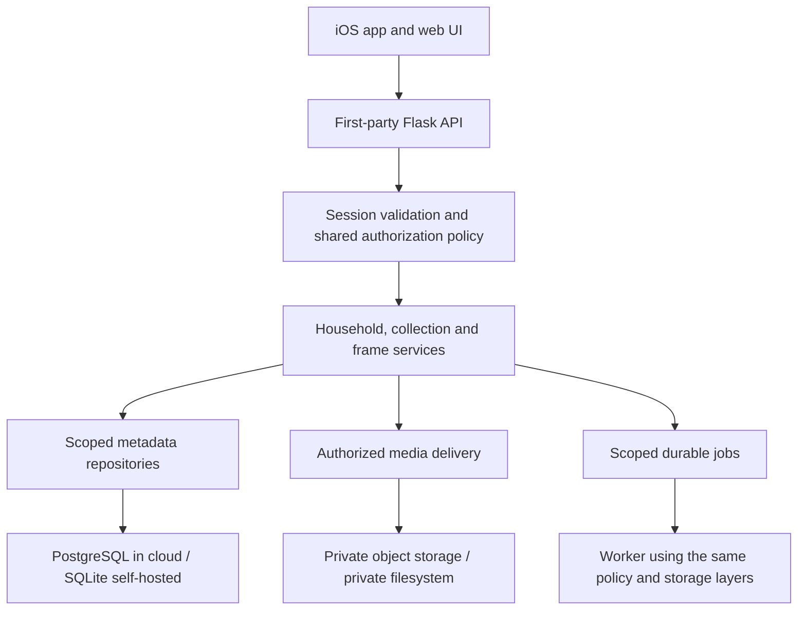

# Hosted and self-hosted release architecture

Status: accepted product requirements and proposed backend design, 2026-10-29.
This is a release specification, not a claim that these controls exist in the
current application. Hosted release is blocked until the isolation tests below
pass against the deployed architecture.

## Product requirements

One iOS app supports two explicit deployment modes:

| Mode | Destination | Account and payment |
| --- | --- | --- |
| OpenFotoFrame Cloud | The configured central service | OpenFotoFrame account; a paid household subscription |
| Your own server | A URL entered by the user or supplied by an invite/setup code | First-party account on that server; independent of cloud billing |

There is no server discovery, network scan, or automatic server selection.
OpenFotoFrame owns authentication in both modes; Authelia is not part of the
release architecture. No VPN detection or prerequisite appears in onboarding.
An unreachable destination produces a connection error and a retry/edit action.

Household members can be invited to selected collections and frames. Membership
alone does not grant the whole library. One person can use the cloud service and
multiple independent self-hosted servers; credentials and sessions remain scoped
to their issuing server. Matching email addresses do not link accounts across
servers.

## Onboarding and invitations

The first screen offers **OpenFotoFrame Cloud**, **Your own server**, and a
**Scan a code** shortcut. A supported email/text invitation opens the corresponding
flow directly and shows the destination before credential entry.

Cloud flow:

1. Log in with account credentials, or use quick login from an authenticated device.
2. Alternatively create an account by accepting an invitation, or by creating a
   new household and choosing a paid plan.
3. Existing accounts accept invitations without creating another account.
4. Invited members use the destination household's subscription and do not see a
   required checkout. A user can belong to several households.
5. Finish required account verification/MFA, then open the selected household.

Self-hosted flow:

1. Enter the server URL or scan a server setup QR code. Confirm the destination.
2. Log in, accept an invitation, or use quick login if the server supports it.
3. New installation ownership is established through an operator bootstrap secret,
   never by letting the first unauthenticated network visitor claim the server.
4. Finish required credential setup/MFA and save the connection.

Account setup supports a new password, password recovery, and server-enforced MFA.
Passwords are never prefilled by invitations. The app stores revocable device
credentials in Keychain rather than retaining account passwords. Self-hosted
recovery must include an operator recovery process when email is unavailable.

### Three QR code purposes

| Purpose | Contains | Effect |
| --- | --- | --- |
| Server setup | Version, deployment mode, server URL | Prefills a destination; grants no access |
| Invitation | Destination and an opaque invitation secret | Starts explicit account/membership acceptance |
| Quick login | Short-lived pairing reference | Starts approval of a new device for an existing account |

For quick login, the authenticated source displays a code; the new device scans
it and creates a pairing challenge. The source explicitly approves the requesting
device and matching confirmation code. Only the requesting device, holding its
own challenge secret, can exchange the approved pairing for a session. Code
possession or scanning alone does not authenticate the new device. Bind pairing
to the issuing server and user, expire it within two minutes, bound attempts, and
consume it atomically. Pairing never elevates collection/frame permissions or
bypasses an account policy requiring recent authentication/MFA. Revoke new devices
from account settings. QR codes contain no password or reusable session token.

Invitation creation requires household owner/admin authority. The server stores
the intended household, explicit collection and frame grants, recipient constraint
when present, issuer, expiry, and a hash of a random secret. Default expiry is 24
hours; acceptance is single-use, revocable, rate-limited, and transactional.
Invitations create ordinary member access in the first release. Owner/admin
promotion is a separate, recently authenticated management action; invitation
links cannot transfer ownership or promote administrators.
Revalidate issuer authority and resource existence at acceptance. Link parameters
cannot choose permissions. Email-bound invitations require a matching verified
address; intentionally transferable invitations must be clearly identified as
such when created. No invitation silently links an existing account by email.

A GET, link preview, or email scanner never consumes an invitation. Acceptance
requires a POST after destination confirmation and account authentication/setup.
Create the account/membership/grants and consume the invitation in one transaction.
A retry after successful acceptance returns the existing outcome to the same user;
concurrent acceptance cannot create another membership or consume it twice.

Initially offer Mail/Messages share sheets, copy link, and QR. Automated email/SMS
providers are separate delivery integrations; delivery never determines authority.
Expired/revoked invitations offer a clear explanation and a request-new-invite path.

### Link routing

Use a project-controlled HTTPS domain for reliable app Universal Links. Self-hosted
server URLs cannot all be declared in one app's associated-domain entitlements.
Self-hosted invitations also have a browser acceptance page and a manual/QR import
path. The shared landing site routes users to their chosen server; it does not
validate account credentials or grant membership. It must not fetch arbitrary
self-hosted URLs on the recipient's behalf.

Keep invitation secrets in a URL fragment where supported, strip them from visible
history after handoff, and exclude them from logs, analytics, referrers, and link
preview metadata. Use no third-party content on the acceptance page. Treat every
link field as untrusted; confirm an unfamiliar destination before contacting it,
reject embedded credentials/unsafe schemes, and never forward existing credentials
to a destination supplied by a link. Manual connection must work without the shared
link site. If the app is not installed, explain installation and reopening the
invitation; do not depend on automatic transfer through an App Store installation.

## Backend deployment

Retain a shared Flask application/domain layer with an explicit cloud/self-hosted
configuration. Separate HTTP handlers from authentication, authorization, collection,
frame, invitation, billing, storage, and job services. Avoid splitting these into
independent network microservices for the first release.

Cloud uses PostgreSQL for transactional metadata/authentication and private object
storage for originals, thumbnails, and rendered snapshots. A worker handles image
processing and bounded export/restore jobs through a durable queue. Self-hosted
mode uses SQLite and a filesystem storage adapter with the same domain rules and
API. Database migrations and authorization contract tests run against both engines.
These are proposed dependencies to evaluate before implementation, not additions
made by this document. Gallery/settings JSON cease to be the authority for scoped
content once the new model is enabled.

Cloud can host multiple households. A self-hosted installation starts with one
household, but uses the same IDs, grants, and isolation checks. Subscription limits
are checked after authorization and do not grant access. Payment events are
verified, deduplicated, and applied to the server-side household entitlement;
a purchase/receipt or client-supplied paid flag is not an authorization credential.
Payment-channel policy and subscription-expiry retention rules require separate
product decisions before checkout implementation.

## Ownership and access model

A **household** is the tenant boundary. A **collection** is a photo set and the
content authorization boundary within that household. Existing multi-photo
**groups** are presentation layouts, not access-control groups.

| Entity | Key relationships and constraints |
| --- | --- |
| User | Stable ID; first-party identity on this server |
| Household | Owns collections, frames, settings, subscription, and audit stream |
| Membership | Unique user/household; owner, admin, or member; active/revoked status |
| Collection | Household-owned set; no implicit access for ordinary members |
| Collection grant | Membership/collection; viewer, contributor, or editor |
| Asset | Household ID and one owning collection ID; opaque asset ID and storage key |
| Group | Household and collection ID; all member assets belong to that collection |
| Frame | Household ID; named display with its own credential and assigned collections |
| Frame grant | Membership/frame; viewer or controller |
| Frame collection | Explicit assignment of a collection to a frame |
| Invitation | Server-owned proposed membership/resource grants and redemption state |
| Device session | User, issuing server, device, expiry, revocation and refresh family |
| Display credential | Household and one frame; separate from human/device sessions |

An asset has one owning collection in the first release. Cross-collection sharing
or moving requires an explicit authorized operation; it cannot emerge from a group
containing a foreign asset ID. Household-wide asset deletion and collection moves
are owner/admin operations because they can change access and display visibility.
A contributor may upload to a permitted collection but cannot edit/delete other
people's assets or change grants. An editor manages content within the granted
collection, including removal. A viewer can read only. Exact UI names may evolve;
the permission semantics and tests must remain explicit.
Removal by an editor is a collection-scoped soft deletion; permanent physical
purge is an owner/admin operation. Restore also revalidates current access.

Household owners/admins have full access inside their household. Only owners can
transfer ownership, manage billing, or delete the household; at least one owner
must remain. Admin is a membership role, never a global user flag. Ordinary members
receive only explicit grants. Granting access to future collections/frames is a
separate explicit policy; the default is none.

A frame viewer may see its name/status/assignments but does not acquire access to
its photos. Assignment labels/details require collection access; otherwise return
only opaque assignment references. A controller can operate playback/power, not browse ungranted photo
content. Controls return opaque state when the caller cannot read the current
collection: no title, filename, thumbnail, or group membership leaks. Only an
owner/admin assigns collections to a frame or enrolls/rotates that frame's display
credential in the first release. Assignment is an explicit grant of those photos
to that physical display. A display reads only its assigned collections and its
own effective settings; it cannot browse the household or call management APIs.

For example, a member invited to **Family photos** and the **Kitchen frame**
cannot list **Private photos**, download their thumbnails, control the **Office
frame**, or acquire those rights by substituting an ID in an API request. Kitchen
frame control does not reveal Private photos if an owner assigns that collection
to the physical display later. Joining a second household creates a separate
membership and grants; the two households never merge their libraries.

## Enforcement

Authorize every action against current server-side membership and grants. The
client's selected household is a request selector, never proof of access. Derive
principal identity from a validated session; never from a submitted user ID,
Remote-User header, hostname, local source address, or subscription status.

Each request performs these steps:

1. Validate the human device/browser session or frame credential and revocation.
2. Resolve the selected household; require current membership or frame assignment.
3. Load the resource inside that household and collection/frame scope.
4. Check the action-specific role/grant, including every referenced resource.
5. Execute the mutation with those constraints in the same transaction, with a
   membership/grant lock or version recheck where needed to prevent revocation races.
6. Record security-relevant changes without recording credentials or invite secrets.

Use a shared policy service for native APIs, server-rendered pages, and jobs.
Repository methods require an authorized scope; avoid unscoped load-by-ID methods
in request code. Deny by default. Inaccessible resource IDs return a consistent
not-found response without existence leaks; forbidden actions on visible resources
may return forbidden. UUIDs are identifiers, not access checks. List counts,
search, pagination, duplicate detection, exports, group membership and error messages
must be scoped before returning results. A batch is validated in full before any
writes; mixed authorized/unauthorized resource IDs fail without partial changes.

Include household IDs in all tenant-owned rows and composite foreign keys. Enforce
same-household membership/grant joins and group/collection/asset relationships at
the database boundary. In PostgreSQL, enable row-level security for tenant tables
and use a non-owner application role without BYPASSRLS. Set transaction-local
identity/scope with both read and write policies; test pooled connection reuse and
missing context. RLS is defense in depth: it does not replace collection/action
checks. SQLite has no equivalent policy layer, so shared scoped repositories and
contract tests are required there too.

### Media, workers and caches

No public uploads, thumbnails, or snapshot directory in cloud mode. Deliver media
through authorized endpoints in the first release, including private storage proxy
streaming; do not issue reusable storage URLs yet. That permits the next request
to honor grant revocation. Bytes already downloaded or a response already in flight
cannot be recalled. Any future signed-URL mode must document its revocation window.

Originals, thumbnails, group snapshots, crop previews, and backup downloads all use
the same authorization boundary. Backend storage keys are generated from scoped
resource records, never client filenames. Scope cache keys by household/resource,
content version, and authorization context; sensitive responses use private/no-store
policies as appropriate. Cross-household duplicate detection/storage deduplication
must not reveal another household's photos.

Workers obtain household and resource scope from a persisted job record and
revalidate initiating-user permissions before delivering exports or other user
requested results. Housekeeping jobs have explicit bounded service authority.
A frame assignment change prevents subsequent reads of removed collections; stale
renders/playlists are invalidated. Display and CEC agent credentials are distinct,
frame-scoped, revocable, and cannot become user or administrator sessions.

Backups are household owner/admin operations. Validate archive paths, IDs and all
relationships on restore. Import into the authorized destination with remapped IDs;
never trust an archive's household ID or restore users, invitations, sessions,
billing records or display credentials into a different household automatically.
Cloud operator access uses a separate, audited operational path and credentials;
there is no universal admin login in the consumer app.

## Authentication and app sessions

Provide a versioned first-party API for sign-in, MFA challenges, account setup,
recovery, session refresh/revocation, invitation acceptance and pairing. Return
explicit identity and permissions; stop inferring login/admin status from HTML.
The release app has no personal server default. Self-hosted and cloud sessions are
isolated by normalized server origin and account; never try another origin with
an existing credential. Normalize harmless pasted management paths to the root
only when the user confirms the destination; do not silently accept arbitrary
reverse-proxy subpaths until the routing contract supports them.

Use opaque short-lived access tokens with server-side revocation checks and rotated
refresh credentials. Store only hashes of bearer credentials on the server; detect
refresh reuse and revoke the affected device family. Native first-party password
entry is supported; do not embed a client secret in the app. Passkey support must
be verified on arbitrary server origins before being advertised; a system-browser
flow can be added using a standard authorization-code/PKCE exchange. MFA completion,
not just password success, is required before issuing a full session.

Keep advanced web editors. Establish their cookie session using an authenticated,
short-lived, single-use bridge posted to the chosen origin. Never put bearer tokens
in web URLs or JavaScript storage. Browser mutations retain CSRF protection. Bind
browser sessions to the parent device's revocation state. Account disablement,
password recovery and membership removal must affect native and web access.

Public destinations require HTTPS. Replace the blanket ATS exception with scoped
local-network support and validate it on supported iOS versions. Local HTTP is an
explicit user-confirmed compatibility mode; never silently downgrade HTTPS, accept
an invalid certificate, or carry cloud credentials to an insecure connection.
Connection failures remain ordinary connection errors without VPN-specific UI.

## Migration and rollout

1. Integrate the latest production backend and this branch's app changes in staging;
   do not design the migration against only the older local app branch.
2. Take a consistent backup of metadata/media and all necessary encryption keys.
   Rehearse restoration and record hashes/counts in the private migration runbook.
3. Under a controlled write pause, import users, existing password hashes, MFA
   material, galleries, groups, mat settings, schedules and frame assignments into
   versioned relational storage. Preserve legacy-hash upgrade behavior. Legacy
   uploaded-by strings remain attribution, not access grants.
4. Create one household and an explicit legacy shared collection for the existing
   library. Map former admins to household owners/admins after identifying at least
   one owner. Preserve existing shared content access through explicit editor grants
   to that collection for migrated ordinary users. Do not grant future collections
   or frames automatically. Map existing frame/control access deliberately.
5. Import the app's saved server URL as a self-hosted profile. Keep the existing app
   identifier where distribution permits; verify upgrade and Keychain behavior on
   device. Establish the owner's first device session using verified credentials or
   a bounded operator-issued enrollment; network reachability is not identity.
6. Keep legacy APIs as scoped adapters to the migrated store during the compatibility
   window, not parallel writable JSON stores. Enroll displays into distinct frame
   credentials, verify playback/power control, then retire shared legacy credentials.
7. Validate selected-collection invitations and quick login with non-admin accounts,
   then TestFlight. Do not expose multi-household cloud service before isolation gates.
8. Rehearse rollback with a compatible application/schema or restore the consistent
   pre-cutover snapshot under a write pause. Old code cannot safely resume writing
   stale JSON after new database writes; define the rollback cutoff before cutover.

A later self-hosted-to-cloud move is a deliberate export/import with destination
ownership verification, scoped ID mapping, subscription setup and frame re-enrollment.
Do not copy sessions/credentials or silently merge accounts with the same email.
Keep the source until destination verification and a deliberate traffic cutover.

## Required release tests

- Two households, a user in both, and a nonmember: no cross-tenant reads, writes,
  counts, media delivery, duplicate-match details, jobs, restores or cache responses.
- One household with disjoint collection/frame grants: no access through guessed
  IDs, group members, bulk requests, thumbnails, search, playback metadata or settings.
- Viewer/contributor/editor/admin/owner and display credentials: positive and negative
  cases for each action, including last-owner protection and forbidden privilege grants.
- Removing membership/grants, deleting/disabling accounts, rotating credentials and
  changing frame assignments deny the next protected request in native and web flows.
- Invitation scanner GETs, replay, expiry, revocation, recipient mismatch, revoked
  issuer, modified grants and concurrent redemption cannot create unauthorized access.
- Quick-login replay, concurrent scanners, denial, mismatched confirmation codes,
  expired challenges and a different issuing server cannot authenticate a device.
- Cloud plan creation, invitation acceptance without checkout, entitlement changes
  and replayed payment events never alter resource membership or grants.
- Connection switching/cancellation never installs a previous server's response,
  cookies, image cache, Keychain session or active-household state in another profile.
- PostgreSQL RLS is exercised using the actual application role; SQLite runs the same
  application authorization cases. Missing/reused transaction scope fails closed.
- Migration is repeatable/idempotent, interrupted imports do not activate partial
  state, count/hash verification passes, and backup/restore/rollback is rehearsed.

## Documentation visibility

This architecture, onboarding flow, permission model, protocol behavior, generic
threat assumptions and isolation test requirements belong in the repository. They
contain no operational secret and make the intended access boundaries reviewable.
Security must come from enforced controls rather than hiding these rules.

Keep actual infrastructure maps, internal addresses, provider credentials, account
identifiers, encryption/signing material, live invitation/QR/session samples,
customer data/backups and unresolved exploit reports in a separately access-controlled
private runbook or secret store. A gitignored file in a public checkout is not a
suitable secret store. Sanitize logs/screenshots before publication. Publish fixed
vulnerability information through a deliberate disclosure process. Do not include
production-specific migration commands or secrets in this document.

## Implementation order and remaining decisions

Implement relational scope and policy tests first, then first-party authentication,
self-hosted migration adapters, native onboarding, invitations/quick login, hosted
entitlements, and cloud operations/release verification. General-release controls
must protect the web app as well as iOS.

Resolve before the corresponding implementation: hosted and invite domains;
plan limits/payment channels; cancellation/retention policy; supported minimum
server versions; mail delivery and email verification; recovery without email;
and final user-facing collection role names. Selected collection/frame grants,
two hosting modes, first-party authentication, no discovery and ordinary connection
errors are requirements, not open questions.

## References

- [OWASP authorization guidance](https://cheatsheetseries.owasp.org/cheatsheets/Authorization_Cheat_Sheet.html):
  deny by default, enforce permissions on every request, protect static resources.
- [PostgreSQL row security](https://www.postgresql.org/docs/current/ddl-rowsecurity.html):
  policy behavior and privileged-role bypass rules.
- [Apple associated domains](https://developer.apple.com/documentation/xcode/supporting-associated-domains):
  app/site association for Universal Links.
